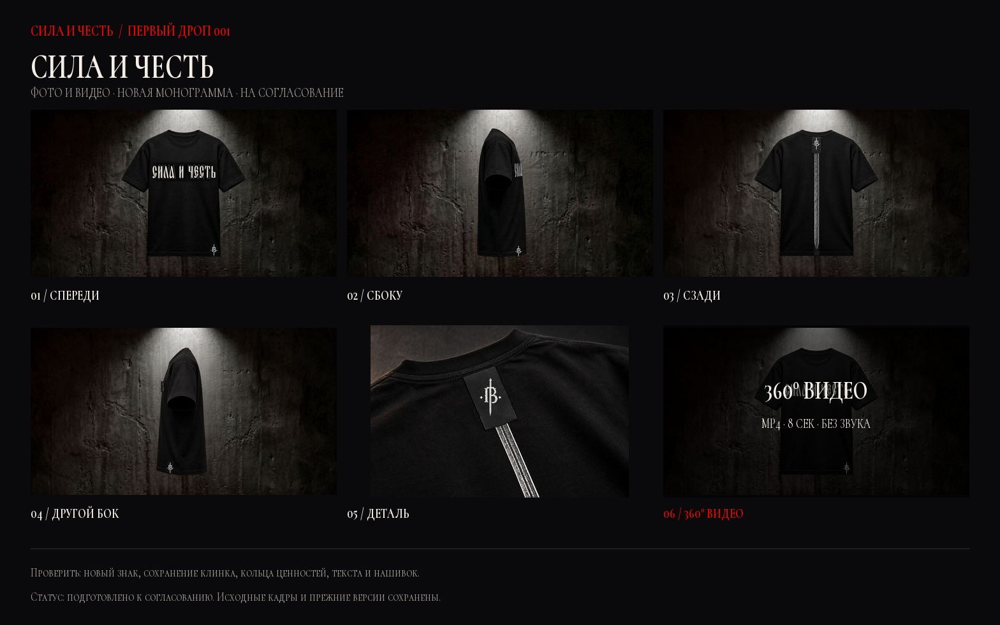
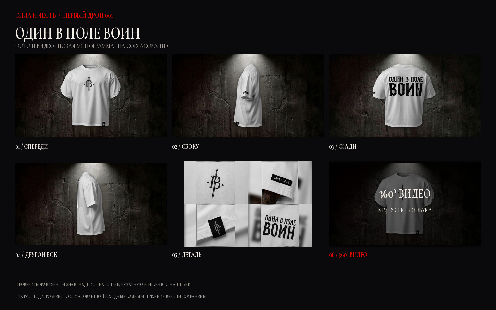

# Архив предыдущих визуальных кандидатов (v3–v8)

> Рендер-пакеты v3–v8 ниже сохранены только для сравнения и отключены: они содержат отличия от оригинальных макетов изделий. Активные товарные материалы — точные производные исходных макетов и документированные crops, с фоном на общем тёмном бетоне, из [`source-proof-v1/README.md`](source-proof-v1/README.md).

**Активные галереи и товарные видео:** см. [`source-proof-v1/README.md`](source-proof-v1/README.md). Это актуальный журнал проверки источников. Фейковые чёрные render-углы удалены; активные фото чёрных моделей снова привязаны к исходным макетам и фото. Подлинный полный 360° подтверждён только для белой модели. Ниже — архив ранее созданных visual candidates; варианты v3–v8 не активировать.

Белая «ОДИН В ПОЛЕ ВОИН» доступна в Mini App как третий товар: **4 900 ₽, S–XXL, предзаказ**. Исходники, старые изображения и ролики сохранены раздельно для истории.

## 1. Футболка «СИЛА И ЧЕСТЬ»

- [Контрольный лист JPG](tee-sila-i-chest-logo-v5-contact-sheet.jpg)
- [Видеообзор 360° MP4](../miniapp/assets/video/tee-sila-i-chest-360-v5.mp4) — 8 секунд, 1080×590, 24 fps, H.264, без звука; короткие кроссфейды и повтор первого кадра для мягкого loop.
- Прежний лист: [версия v4](tee-sila-i-chest-logo-v4-contact-sheet.jpg). Прежнее видео: [360° v4](../miniapp/assets/video/tee-sila-i-chest-360-v4.mp4).

| Кадр | Файл |
|---|---|
| Спереди | [01-front.jpg](../miniapp/assets/spin/tee-sich-01-v4.jpg) |
| Сбоку | [03-side.jpg](../miniapp/assets/spin/tee-sich-03-v4.jpg) |
| Сзади | [05-back.jpg](../miniapp/assets/spin/tee-sich-05-v4.jpg) |
| Другой бок | [07-side.jpg](../miniapp/assets/spin/tee-sich-07-v4.jpg) |
| Исходная раскладка | [перед и спина](../miniapp/assets/drop/tee-flatlay-v2.jpg) |

Полный набор ракурсов: [01](../miniapp/assets/spin/tee-sich-01-v4.jpg) · [02](../miniapp/assets/spin/tee-sich-02-v4.jpg) · [03](../miniapp/assets/spin/tee-sich-03-v4.jpg) · [04](../miniapp/assets/spin/tee-sich-04-v4.jpg) · [05](../miniapp/assets/spin/tee-sich-05-v4.jpg) · [06](../miniapp/assets/spin/tee-sich-06-v4.jpg) · [07](../miniapp/assets/spin/tee-sich-07-v4.jpg) · [08](../miniapp/assets/spin/tee-sich-08-v4.jpg).

## 2. Футболка «ВЗГЛЯД»

- [Контрольный лист JPG](tee-vzglyad-logo-v4-contact-sheet.jpg)
- [Видеообзор 360° MP4](../miniapp/assets/video/tee-vzglyad-360-v5.mp4) — 8 секунд, 1080×590, 24 fps, H.264, без звука; короткие кроссфейды и повтор первого кадра для мягкого loop.
- Прежний лист: [версия v3](tee-vzglyad-logo-v3-contact-sheet.jpg). Прежнее видео: [360° v4](../miniapp/assets/video/tee-vzglyad-360-v4.mp4).

| Кадр | Файл |
|---|---|
| Спереди | [01-front.jpg](../miniapp/assets/spin/tee-vzglyad-01-v3.jpg) |
| Сбоку | [03-side.jpg](../miniapp/assets/spin/tee-vzglyad-03-v3.jpg) |
| Сзади | [05-back.jpg](../miniapp/assets/spin/tee-vzglyad-05-v3.jpg) |
| Другой бок | [07-side.jpg](../miniapp/assets/spin/tee-vzglyad-07-v3.jpg) |
| Исходный макет заказчицы · перед и спина | [tee-vzglyad-graphic.jpg](../miniapp/assets/drop/tee-vzglyad-graphic.jpg) |

Полный набор ракурсов: [01](../miniapp/assets/spin/tee-vzglyad-01-v3.jpg) · [02](../miniapp/assets/spin/tee-vzglyad-02-v3.jpg) · [03](../miniapp/assets/spin/tee-vzglyad-03-v3.jpg) · [04](../miniapp/assets/spin/tee-vzglyad-04-v3.jpg) · [05](../miniapp/assets/spin/tee-vzglyad-05-v3.jpg) · [06](../miniapp/assets/spin/tee-vzglyad-06-v3.jpg) · [07](../miniapp/assets/spin/tee-vzglyad-07-v3.jpg) · [08](../miniapp/assets/spin/tee-vzglyad-08-v3.jpg).

Исходный клиентский макет переда и спины также доступен в фотогалерее без изменений. Публичное название остаётся «ВЗГЛЯД», технический ID — `tee-vzglyad`. Восьмикадровые предметные рендеры и их ролик не считаются исправленными/согласованными до сверки каждого ракурса с этим макетом.

## 3. Архивный кандидат v8 для «ОДИН В ПОЛЕ ВОИН» (не активные медиа)

- [Контрольный лист JPG](tee-odin-v-pole-voin-logo-v8-contact-sheet.jpg)
- [Товарное видео 360° MP4](../miniapp/assets/video/tee-odin-v-pole-voin-360-v8.mp4) — 8 секунд, 1080×590, 24 fps, H.264, без звука; тот же бетонный фон, масштаб и кроссфейды, что у чёрных футболок.
- [Крупные детали JPG](../miniapp/assets/drop/odin-voin-detail-v3.jpg) — монограмма, надпись и нашивки.
- В v8 сохранены свободные перед и спинка, обычный ворот, полные манжеты, ровный подол, общие центр и размер. На задних ракурсах 04/05/06 ткань восстановлена из нетронутых исходных кадров одним бесшовным участком; старая печать удалена без letter-shaped inpaint-пятен, а точная новая надпись не искривляется волнами и наследует освещение хлопка. Боковые кадры очищены от дубля нашивки, обрезанных букв и краевых артефактов; фирменные элементы сохранены.
- Предыдущий вариант: [контрольный лист v7](tee-odin-v-pole-voin-logo-v7-contact-sheet.jpg) и [видео v7](../miniapp/assets/video/tee-odin-v-pole-voin-360-v7.mp4) сохранены только для сравнения и не используются витриной.
- Более ранние версии: [контрольный лист v6](tee-odin-v-pole-voin-logo-v6-contact-sheet.jpg), [видео v6](../miniapp/assets/video/tee-odin-v-pole-voin-360-v6.mp4), [контрольный лист v5](tee-odin-v-pole-voin-logo-v5-contact-sheet.jpg), [видео v5](../miniapp/assets/video/tee-odin-v-pole-voin-360-v5.mp4), [контрольный лист v4](tee-odin-v-pole-voin-logo-v4-contact-sheet.jpg), [видео v4](../miniapp/assets/video/tee-odin-v-pole-voin-360-v4.mp4), [контрольный лист v3](tee-odin-v-pole-voin-logo-v3-contact-sheet.jpg) и [видео v3](../miniapp/assets/video/tee-odin-v-pole-voin-360-v3.mp4) также сохранены и не активны.
- В Mini App: 5 фото, 8 ракурсов вращения, видео, размеры S–XXL и существующий checkout. Цена **4 900 ₽**, статус **предзаказ**.

Витринные ракурсы: [01](../miniapp/assets/spin/odin-voin-01-v8.jpg) · [02](../miniapp/assets/spin/odin-voin-02-v8.jpg) · [03](../miniapp/assets/spin/odin-voin-03-v8.jpg) · [04](../miniapp/assets/spin/odin-voin-04-v8.jpg) · [05](../miniapp/assets/spin/odin-voin-05-v8.jpg) · [06](../miniapp/assets/spin/odin-voin-06-v8.jpg) · [07](../miniapp/assets/spin/odin-voin-07-v8.jpg) · [08](../miniapp/assets/spin/odin-voin-08-v8.jpg).

### Полный белый review-комплект

- [Полный макет JPG](brand-logo-review-2026-10-25-v2/odin-v-pole-voin-board.jpg) — уточнённая монограмма, надпись фирменной гарнитурой, нашивки и детали.
- [Десять исправленных ракурсов JPG](brand-logo-review-2026-10-25-v2/odin-v-pole-voin-frames.jpg)
- [Видеообзор MP4](brand-logo-review-2026-10-25-v2/odin-v-pole-voin-review.mp4) — 10 секунд, 720×1280, 30 fps, H.264, исходная звуковая дорожка AAC.
- [Постер JPG](brand-logo-review-2026-10-25-v2/odin-v-pole-voin-poster.jpg)
- Нетронутые исходники сохранены отдельно: задние [04](brand-logo-review-2026-10-25-v2/white-sources/odin-voin-04-original.jpg), [05](brand-logo-review-2026-10-25-v2/white-sources/odin-voin-05-original.jpg), [06](brand-logo-review-2026-10-25-v2/white-sources/odin-voin-06-original.jpg) и боковые [03](brand-logo-review-2026-10-25-v2/white-sources/odin-voin-03-original.jpg), [08](brand-logo-review-2026-10-25-v2/white-sources/odin-voin-08-original.jpg). Генератор `tools/refine_white_spin.py` использует только committed inputs и не требует архив переписки.
- Отдельные кадры: [01](brand-logo-review-2026-10-25-v2/white-frames/odin-voin-01.jpg) · [02](brand-logo-review-2026-10-25-v2/white-frames/odin-voin-02.jpg) · [03](brand-logo-review-2026-10-25-v2/white-frames/odin-voin-03.jpg) · [04](brand-logo-review-2026-10-25-v2/white-frames/odin-voin-04.jpg) · [05](brand-logo-review-2026-10-25-v2/white-frames/odin-voin-05.jpg) · [06](brand-logo-review-2026-10-25-v2/white-frames/odin-voin-06.jpg) · [07](brand-logo-review-2026-10-25-v2/white-frames/odin-voin-07.jpg) · [08](brand-logo-review-2026-10-25-v2/white-frames/odin-voin-08.jpg) · [09](brand-logo-review-2026-10-25-v2/white-frames/odin-voin-09.jpg) · [10](brand-logo-review-2026-10-25-v2/white-frames/odin-voin-10.jpg).
- [Прежний белый макет](brand-logo-review-2026-10-25/odin-v-pole-voin-board.jpg) сохранён для сравнения.

Исходный `task_materials/chat_export/video_files/0818.mp4` сохранён без изменений. Архивный review MP4 — монтаж из десяти исправленных кадров исходного вращения; активные товарные MP4 — новый восьмисекундный монтаж восьми landscape-ракурсов. Ни тот ни другой не является новой живой съёмкой. Старый неактивный `field-tee-001` не используется как новый SKU.

## 4. Жетон

- [Контрольный лист JPG](tag-sila-i-chest-logo-v3-contact-sheet.jpg)
- [Лицевая гравировка](../miniapp/assets/spin/tag-sich-01-v3.jpg) · [ракурс 02](../miniapp/assets/spin/tag-sich-02-v3.jpg) · [ракурс 03](../miniapp/assets/spin/tag-sich-03-v3.jpg) · [деталь 04](../miniapp/assets/spin/tag-sich-04-v3.jpg).

## 5. Фильм выпуска с уточнённой монограммой

- [Контрольный лист JPG](drop-vzglyad-logo-v5-18s-contact-sheet.jpg)
- [Фильм выпуска MP4](../miniapp/assets/video/drop-vzglyad-18s-v5.mp4) — 18 секунд, 720×1280, 30 fps, H.264, исходная звуковая дорожка AAC.
- [Постер JPG](../miniapp/assets/video/drop-vzglyad-18s-v5-thumb.jpg)
- Предыдущий вариант: [контрольный лист v4](drop-vzglyad-logo-v4-18s-contact-sheet.jpg), [MP4 v4](../miniapp/assets/video/drop-vzglyad-18s-v4.mp4); более ранние версии v2–v3 сохранены.

В версии v5 слово в сцене «КРУГ ЦЕННОСТЕЙ» соответствует макету photo_18 («ВЕРА»), а спорный чрезмерно крупный AI-крупный план горловины заменён существующей исходной раскладкой `tee-flatlay-v2.jpg` — без изменения исходника и перерисовки графики. Девять сцен сохраняют тёмную тему, красный акцент и название «ВЗГЛЯД». Это монтаж предметных визуализаций, не новая живая съёмка.

## Типографика и знак

- Точный контур «СИЛА И ЧЕСТЬ» извлечён из присланного референса и использован как графический wordmark.
- Остальные тексты и титры набраны локальной кириллической гарнитурой Sila Chest. Это стилевое приближение к референсу; исходное название шрифта не установлено и точное совпадение не заявляется.
- На чёрных и белых вещах использован присланный фактурный знак с мечом: светлый вариант на тёмной ткани и тёмный на белой. Потёртость сохранена и в альфа-канале, и в тоне краски; силуэт не перерисован.
- Неизменная копия исходного знака: [customer-sword-reference.jpg](../miniapp/assets/brand/customer-sword-reference.jpg). Генераторы используют её и не требуют архива переписки в sparse CI.
- Пакеты v3–v8 и связанные 360°-рендеры ниже — только архив, не активная витрина. Актуальные товарные галереи/видео перечислены в [`source-proof-v1/README.md`](source-proof-v1/README.md); активный герой «СИЛА И ЧЕСТЬ» остаётся `miniapp/assets/drop/hero-sila-chest-v2.jpg`. Архивные источники сохранены.

## 6. Заставка и главный кадр

- [Фон заставки без вступления MP4](../miniapp/assets/video/welcome-no-intro-22s.mp4) — 22,17 секунды, 540×720, 24 fps, H.264, без звука. Удалены только 2,67 секунды «ВОРОЖБИТОВ ПРЕДСТАВЛЯЕТ» и переходная вспышка; исходный ролик сохранён.
- [Главный кадр без постороннего ярлыка JPG](../miniapp/assets/drop/hero-sila-chest-v2.jpg) — удалена только маленькая метка на манжете левого рукава. Фирменная нашивка у подола, монограммы и другие детали сохранены.

Приветствие Mini App остаётся на экране до нажатия «Войти в магазин». Плашка длительности берёт значение из метаданных видео.

## Что проверить

- соответствие уточнённой монограммы присланному знаку и её цвет на ткани;
- сохранение клинка, кольца ценностей, изображения глаз, надписей и нашивок;
- надпись «ОДИН В ПОЛЕ ВОИН» на белой спине и в деталях;
- front / side / back / второй side и крупные планы;
- единые 1080×590, центрирование и масштаб во всех 360°, плавные кроссфейды без сдвига изделия и мягкий loop в трёх новых восьмисекундных видео;
- белую карточку, выбор размера, корзину и оформление предзаказа;
- единый тёмный бетонный фон, свет и общий стиль комплекта, особенно у белой футболки.

## Важно

- Это предметные визуализации и монтажные видео, а не заявленная живая видеосъёмка.
- Материалы подготовлены **на согласование**, а не согласованы.
- Производственная размерная сетка сюда не входит: её нужно получить от производства, а не выдумывать.
- Реальные платежи в ходе подготовки не выполняются.
- После комментариев заказчицы правки вносятся в новые версии; исходники не удаляются.
