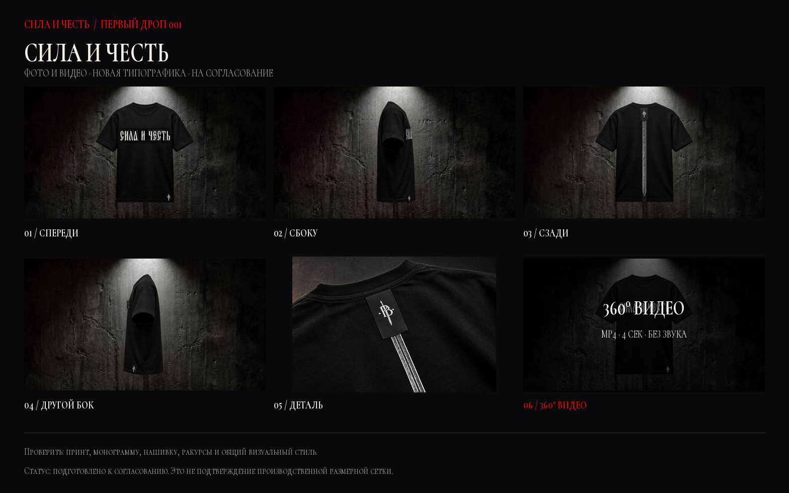
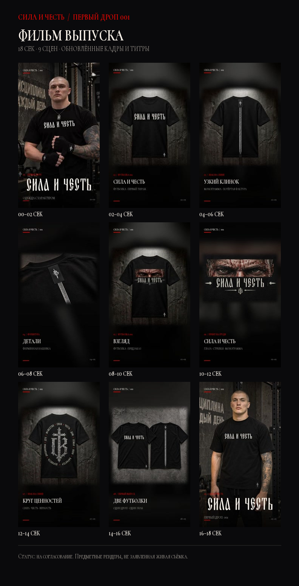

# СИЛА И ЧЕСТЬ 001 — фото и видео на согласование

**Статус:** материалы подготовлены к проверке заказчицей, но ещё не отмечены как согласованные.

Для первичного просмотра достаточно отправить три контрольных листа и четыре MP4. Ниже также находятся ссылки на отдельные исходные кадры, чтобы можно было комментировать конкретный ракурс.

## 1. Футболка «СИЛА И ЧЕСТЬ»

- [Контрольный лист JPG](tee-sila-i-chest-contact-sheet.jpg)
- [Видеообзор 360° MP4](../miniapp/assets/video/tee-sila-i-chest-360-v2.mp4) — 4 секунды, 1080×590, 24 fps, H.264, без звука.

| Кадр | Файл |
|---|---|
| Спереди | [01-front.jpg](../miniapp/assets/spin/tee-sich-01-v2.jpg) |
| Сбоку | [03-side.jpg](../miniapp/assets/spin/tee-sich-03-v2.jpg) |
| Сзади | [05-back.jpg](../miniapp/assets/spin/tee-sich-05-v2.jpg) |
| Другой бок | [07-side.jpg](../miniapp/assets/spin/tee-sich-07-v2.jpg) |
| Фурнитура / нашивка | [detail.jpg](../miniapp/assets/drop/tee-detail-v4.jpg) |

Полный набор промежуточных ракурсов: [01](../miniapp/assets/spin/tee-sich-01-v2.jpg) · [02](../miniapp/assets/spin/tee-sich-02-v2.jpg) · [03](../miniapp/assets/spin/tee-sich-03-v2.jpg) · [04](../miniapp/assets/spin/tee-sich-04-v2.jpg) · [05](../miniapp/assets/spin/tee-sich-05-v2.jpg) · [06](../miniapp/assets/spin/tee-sich-06-v2.jpg) · [07](../miniapp/assets/spin/tee-sich-07-v2.jpg) · [08](../miniapp/assets/spin/tee-sich-08-v2.jpg).

## 2. Футболка «ВЗГЛЯД»

- [Контрольный лист JPG](tee-vzglyad-contact-sheet.jpg)
- [Видеообзор 360° MP4](../miniapp/assets/video/tee-vzglyad-360-v2.mp4) — 4 секунды, 1080×590, 24 fps, H.264, без звука.

| Кадр | Файл |
|---|---|
| Спереди | [01-front.jpg](../miniapp/assets/spin/tee-vzglyad-01.jpg) |
| Сбоку | [03-side.jpg](../miniapp/assets/spin/tee-vzglyad-03.jpg) |
| Сзади | [05-back.jpg](../miniapp/assets/spin/tee-vzglyad-05.jpg) |
| Другой бок | [07-side.jpg](../miniapp/assets/spin/tee-vzglyad-07.jpg) |
| Принт на груди крупным планом | [detail.jpg](../miniapp/assets/drop/tee-vzglyad-detail.jpg) |

Полный набор промежуточных ракурсов: [01](../miniapp/assets/spin/tee-vzglyad-01.jpg) · [02](../miniapp/assets/spin/tee-vzglyad-02.jpg) · [03](../miniapp/assets/spin/tee-vzglyad-03.jpg) · [04](../miniapp/assets/spin/tee-vzglyad-04.jpg) · [05](../miniapp/assets/spin/tee-vzglyad-05.jpg) · [06](../miniapp/assets/spin/tee-vzglyad-06.jpg) · [07](../miniapp/assets/spin/tee-vzglyad-07.jpg) · [08](../miniapp/assets/spin/tee-vzglyad-08.jpg).

## 3. Фильм выпуска с обновлённой типографикой

- [Контрольный лист JPG](drop-vzglyad-18s-contact-sheet.jpg)
- [Фильм выпуска MP4](../miniapp/assets/video/drop-vzglyad-18s.mp4) — 18 секунд, 720×1280, 30 fps, H.264, исходная звуковая дорожка AAC.
- [Постер JPG](../miniapp/assets/video/drop-vzglyad-18s-thumb.jpg)

Ролик заново собран из девяти сцен с обновлёнными принтами и новыми титрами. Старый `campaign-v11.mp4` сохранён в исходниках, но нативный сценарий бота использует новый файл.

## Типографика

- Точный контур «СИЛА И ЧЕСТЬ» извлечён из присланного референса и использован как графический wordmark.
- Остальные тексты и титры набраны локальной кириллической гарнитурой Sila Chest. Это стилевое приближение к референсу; исходное название шрифта не установлено и точное совпадение не заявляется.
- Обновлены активные товарные кадры, деталь «ВЗГЛЯД», hero, изображения нативного лукбука, вывеска магазина, оба 360° MP4 и фильм выпуска. Исходные файлы старых роликов сохранены.

## 4. Заставка и главный кадр

- [Фон заставки без вступления MP4](../miniapp/assets/video/welcome-no-intro-22s.mp4) — 22,17 секунды, 540×720, 24 fps, H.264, без звука. Удалены только 2,67 секунды «ВОРОЖБИТОВ ПРЕДСТАВЛЯЕТ» и переходная вспышка; исходный 25-секундный ролик сохранён.
- [Главный кадр без постороннего ярлыка JPG](../miniapp/assets/drop/hero-sila-chest-v2.jpg) — удалена только маленькая метка на манжете левого рукава. Фирменная нашивка у подола, монограммы и другие детали сохранены.

Приветствие Mini App остаётся на экране до нажатия «Войти в магазин». Плашка длительности берёт значение из метаданных видео. В teaser и контрольных листах восстановлено название «ВЗГЛЯД»; технический ID `tee-vzglyad` сохранён для совместимости заказов.

## Что проверить

- соответствие принтов, монограммы и нашивки исходному дизайну;
- читаемость надписей и внешний вид фурнитуры;
- front / side / back / второй side и крупный план;
- последовательность восьми ракурсов в 360°-видео;
- единый тёмный фон, свет и общий стиль двух футболок.

## Важно

- Это предметные визуализации и видео, собранное из восьми подготовленных ракурсов, а не заявленная живая видеосъёмка.
- Производственная размерная сетка сюда не входит: её нужно получить от производства, а не выдумывать.
- После комментариев заказчицы правки вносятся в исходные кадры, затем заново собираются контрольный лист и MP4.
