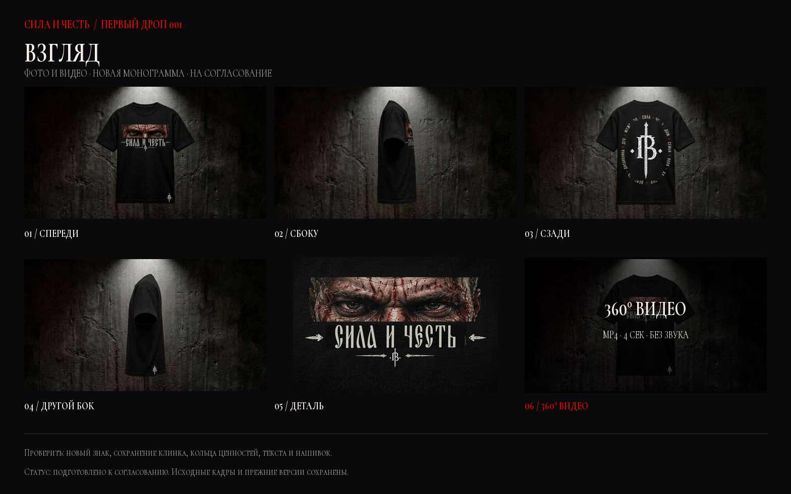
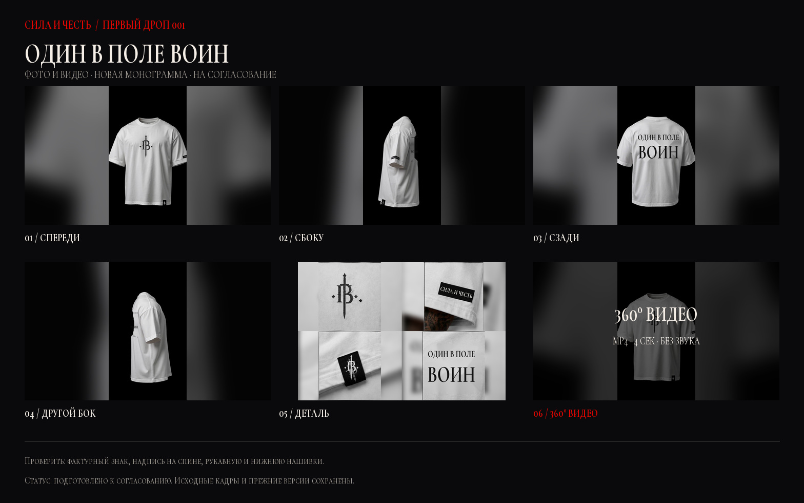
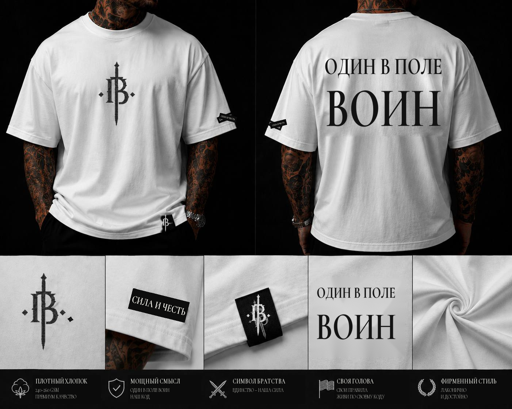
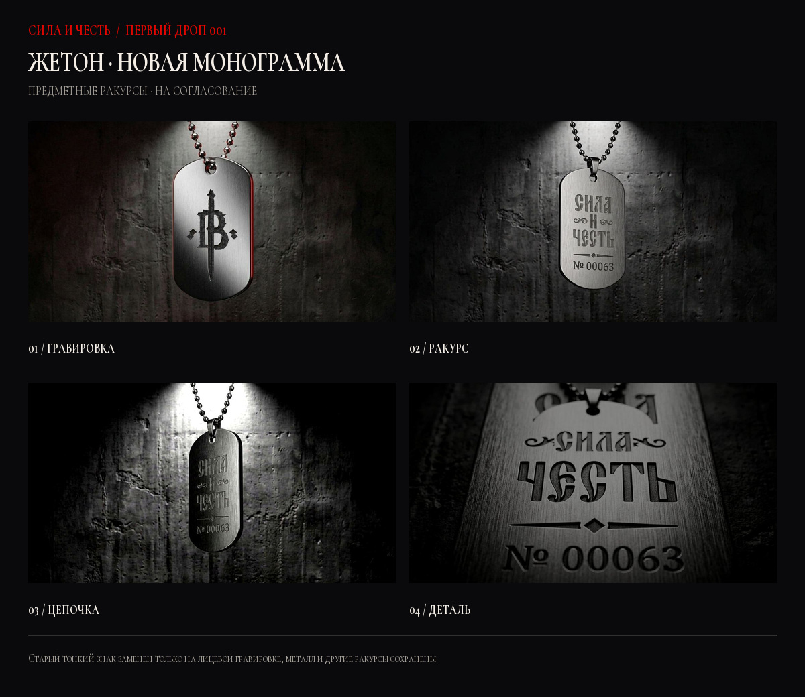
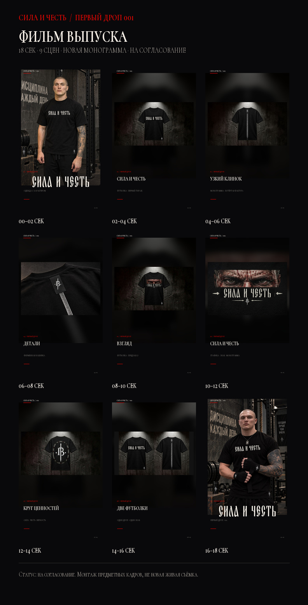

# СИЛА И ЧЕСТЬ 001 — фото и видео на согласование

**Статус:** материалы подготовлены к проверке заказчицей, но ещё не отмечены как согласованные.

Уточнённая фактурная монограмма с мечом применена к трём активным футболкам, жетону, деталям, товарным видео и интерфейсным знакам. Белая «ОДИН В ПОЛЕ ВОИН» добавлена в Mini App как полноценный третий товар: **4 900 ₽, S–XXL, предзаказ**. Прежние изображения, ролики и исходники сохранены.

## 1. Футболка «СИЛА И ЧЕСТЬ»

- [Контрольный лист JPG](tee-sila-i-chest-logo-v4-contact-sheet.jpg)
- [Видеообзор 360° MP4](../miniapp/assets/video/tee-sila-i-chest-360-v4.mp4) — 4 секунды, 1080×590, 24 fps, H.264, без звука.
- Прежний лист: [версия v3](tee-sila-i-chest-logo-v3-contact-sheet.jpg). Прежнее видео: [360° v3](../miniapp/assets/video/tee-sila-i-chest-360-v3.mp4).

| Кадр | Файл |
|---|---|
| Спереди | [01-front.jpg](../miniapp/assets/spin/tee-sich-01-v4.jpg) |
| Сбоку | [03-side.jpg](../miniapp/assets/spin/tee-sich-03-v4.jpg) |
| Сзади | [05-back.jpg](../miniapp/assets/spin/tee-sich-05-v4.jpg) |
| Другой бок | [07-side.jpg](../miniapp/assets/spin/tee-sich-07-v4.jpg) |
| Фурнитура / нашивка | [detail.jpg](../miniapp/assets/drop/tee-detail-v6.jpg) |

Полный набор ракурсов: [01](../miniapp/assets/spin/tee-sich-01-v4.jpg) · [02](../miniapp/assets/spin/tee-sich-02-v4.jpg) · [03](../miniapp/assets/spin/tee-sich-03-v4.jpg) · [04](../miniapp/assets/spin/tee-sich-04-v4.jpg) · [05](../miniapp/assets/spin/tee-sich-05-v4.jpg) · [06](../miniapp/assets/spin/tee-sich-06-v4.jpg) · [07](../miniapp/assets/spin/tee-sich-07-v4.jpg) · [08](../miniapp/assets/spin/tee-sich-08-v4.jpg).

## 2. Футболка «ВЗГЛЯД»

- [Контрольный лист JPG](tee-vzglyad-logo-v3-contact-sheet.jpg)
- [Видеообзор 360° MP4](../miniapp/assets/video/tee-vzglyad-360-v4.mp4) — 4 секунды, 1080×590, 24 fps, H.264, без звука.
- Прежний лист: [версия v2](tee-vzglyad-logo-v2-contact-sheet.jpg). Прежнее видео: [360° v3](../miniapp/assets/video/tee-vzglyad-360-v3.mp4).

| Кадр | Файл |
|---|---|
| Спереди | [01-front.jpg](../miniapp/assets/spin/tee-vzglyad-01-v3.jpg) |
| Сбоку | [03-side.jpg](../miniapp/assets/spin/tee-vzglyad-03-v3.jpg) |
| Сзади | [05-back.jpg](../miniapp/assets/spin/tee-vzglyad-05-v3.jpg) |
| Другой бок | [07-side.jpg](../miniapp/assets/spin/tee-vzglyad-07-v3.jpg) |
| Принт на груди крупным планом | [detail.jpg](../miniapp/assets/drop/tee-vzglyad-detail-v3.jpg) |

Полный набор ракурсов: [01](../miniapp/assets/spin/tee-vzglyad-01-v3.jpg) · [02](../miniapp/assets/spin/tee-vzglyad-02-v3.jpg) · [03](../miniapp/assets/spin/tee-vzglyad-03-v3.jpg) · [04](../miniapp/assets/spin/tee-vzglyad-04-v3.jpg) · [05](../miniapp/assets/spin/tee-vzglyad-05-v3.jpg) · [06](../miniapp/assets/spin/tee-vzglyad-06-v3.jpg) · [07](../miniapp/assets/spin/tee-vzglyad-07-v3.jpg) · [08](../miniapp/assets/spin/tee-vzglyad-08-v3.jpg).

На спине изменена только центральная монограмма: клинок, изображение глаз, кольцо ценностей и текстовые элементы сохранены. Публичное название остаётся «ВЗГЛЯД», технический ID — `tee-vzglyad`.

## 3. Белая футболка «ОДИН В ПОЛЕ ВОИН» — активный товар

- [Контрольный лист JPG](tee-odin-v-pole-voin-logo-v3-contact-sheet.jpg)
- [Товарное видео 360° MP4](../miniapp/assets/video/tee-odin-v-pole-voin-360-v3.mp4) — 4 секунды, 720×1280, 24 fps, H.264, без звука; исходный портретный ракурс сохранён без кадрирования.
- [Крупные детали JPG](../miniapp/assets/drop/odin-voin-detail-v3.jpg) — монограмма, надпись и нашивки.
- В Mini App: 5 фото, 8 ракурсов вращения, видео, размеры S–XXL и существующий checkout. Цена **4 900 ₽**, статус **предзаказ**.

Витринные ракурсы: [01](../miniapp/assets/spin/odin-voin-01-v3.jpg) · [02](../miniapp/assets/spin/odin-voin-02-v3.jpg) · [03](../miniapp/assets/spin/odin-voin-03-v3.jpg) · [04](../miniapp/assets/spin/odin-voin-04-v3.jpg) · [05](../miniapp/assets/spin/odin-voin-05-v3.jpg) · [06](../miniapp/assets/spin/odin-voin-06-v3.jpg) · [07](../miniapp/assets/spin/odin-voin-07-v3.jpg) · [08](../miniapp/assets/spin/odin-voin-08-v3.jpg).

### Полный белый review-комплект

- [Полный макет JPG](brand-logo-review-2026-10-25-v2/odin-v-pole-voin-board.jpg) — уточнённая монограмма, надпись фирменной гарнитурой, нашивки и детали.
- [Десять исправленных ракурсов JPG](brand-logo-review-2026-10-25-v2/odin-v-pole-voin-frames.jpg)
- [Видеообзор MP4](brand-logo-review-2026-10-25-v2/odin-v-pole-voin-review.mp4) — 10 секунд, 720×1280, 30 fps, H.264, исходная звуковая дорожка AAC.
- [Постер JPG](brand-logo-review-2026-10-25-v2/odin-v-pole-voin-poster.jpg)
- Отдельные кадры: [01](brand-logo-review-2026-10-25-v2/white-frames/odin-voin-01.jpg) · [02](brand-logo-review-2026-10-25-v2/white-frames/odin-voin-02.jpg) · [03](brand-logo-review-2026-10-25-v2/white-frames/odin-voin-03.jpg) · [04](brand-logo-review-2026-10-25-v2/white-frames/odin-voin-04.jpg) · [05](brand-logo-review-2026-10-25-v2/white-frames/odin-voin-05.jpg) · [06](brand-logo-review-2026-10-25-v2/white-frames/odin-voin-06.jpg) · [07](brand-logo-review-2026-10-25-v2/white-frames/odin-voin-07.jpg) · [08](brand-logo-review-2026-10-25-v2/white-frames/odin-voin-08.jpg) · [09](brand-logo-review-2026-10-25-v2/white-frames/odin-voin-09.jpg) · [10](brand-logo-review-2026-10-25-v2/white-frames/odin-voin-10.jpg).
- [Прежний белый макет](brand-logo-review-2026-10-25/odin-v-pole-voin-board.jpg) сохранён для сравнения.

Исходный `task_materials/chat_export/video_files/0818.mp4` сохранён без изменений. Review MP4 — монтаж из десяти исправленных кадров исходного вращения, а не новая живая съёмка. Старый неактивный `field-tee-001` не используется как новый SKU.

## 4. Жетон

- [Контрольный лист JPG](tag-sila-i-chest-logo-v3-contact-sheet.jpg)
- [Лицевая гравировка](../miniapp/assets/spin/tag-sich-01-v3.jpg) · [ракурс 02](../miniapp/assets/spin/tag-sich-02-v3.jpg) · [ракурс 03](../miniapp/assets/spin/tag-sich-03-v3.jpg) · [деталь 04](../miniapp/assets/spin/tag-sich-04-v3.jpg).

## 5. Фильм выпуска с уточнённой монограммой

- [Контрольный лист JPG](drop-vzglyad-logo-v3-18s-contact-sheet.jpg)
- [Фильм выпуска MP4](../miniapp/assets/video/drop-vzglyad-18s-v3.mp4) — 18 секунд, 720×1280, 30 fps, H.264, исходная звуковая дорожка AAC.
- [Постер JPG](../miniapp/assets/video/drop-vzglyad-18s-v3-thumb.jpg)
- Прежний лист: [18 секунд, версия v2](drop-vzglyad-logo-v2-18s-contact-sheet.jpg). Прежний фильм: [drop-vzglyad-18s-v2.mp4](../miniapp/assets/video/drop-vzglyad-18s-v2.mp4).

Девять сцен сохраняют тёмную премиальную тему, красный акцент, публичное название «ВЗГЛЯД» и очищенный рукав hero. Это монтаж предметных визуализаций, а не заявленная новая живая съёмка.

## Типографика и знак

- Точный контур «СИЛА И ЧЕСТЬ» извлечён из присланного референса и использован как графический wordmark.
- Остальные тексты и титры набраны локальной кириллической гарнитурой Sila Chest. Это стилевое приближение к референсу; исходное название шрифта не установлено и точное совпадение не заявляется.
- На чёрных и белых вещах использован присланный фактурный знак с мечом: светлый вариант на тёмной ткани и тёмный на белой. Потёртость сохранена и в альфа-канале, и в тоне краски; силуэт не перерисован.
- Неизменная копия исходного знака: [customer-sword-reference.jpg](../miniapp/assets/brand/customer-sword-reference.jpg). Генераторы используют её и не требуют архива переписки в sparse CI.
- Обновлены активные товарные кадры, детали, жетон, три 360° MP4, тизер, [круглая печать](../miniapp/assets/sila-chest-seal-v3.jpg), [аватар](../miniapp/assets/bot-avatar-v3.jpg) и [набор интерфейсных знаков](../custom_emoji_pack_v3/preview_grid.png). Исходные файлы старых версий сохранены.

## 6. Заставка и главный кадр

- [Фон заставки без вступления MP4](../miniapp/assets/video/welcome-no-intro-22s.mp4) — 22,17 секунды, 540×720, 24 fps, H.264, без звука. Удалены только 2,67 секунды «ВОРОЖБИТОВ ПРЕДСТАВЛЯЕТ» и переходная вспышка; исходный ролик сохранён.
- [Главный кадр без постороннего ярлыка JPG](../miniapp/assets/drop/hero-sila-chest-v2.jpg) — удалена только маленькая метка на манжете левого рукава. Фирменная нашивка у подола, монограммы и другие детали сохранены.

Приветствие Mini App остаётся на экране до нажатия «Войти в магазин». Плашка длительности берёт значение из метаданных видео.

## Что проверить

- соответствие уточнённой монограммы присланному знаку и её цвет на ткани;
- сохранение клинка, кольца ценностей, изображения глаз, надписей и нашивок;
- надпись «ОДИН В ПОЛЕ ВОИН» на белой спине и в деталях;
- front / side / back / второй side и крупные планы;
- последовательность ракурсов в трёх 360°-видео и девять сцен тизера;
- белую карточку, выбор размера, корзину и оформление предзаказа;
- единый тёмный фон, свет и общий стиль комплекта.

## Важно

- Это предметные визуализации и монтажные видео, а не заявленная живая видеосъёмка.
- Материалы подготовлены **на согласование**, а не согласованы.
- Производственная размерная сетка сюда не входит: её нужно получить от производства, а не выдумывать.
- Реальные платежи в ходе подготовки не выполняются.
- После комментариев заказчицы правки вносятся в новые версии; исходники не удаляются.
